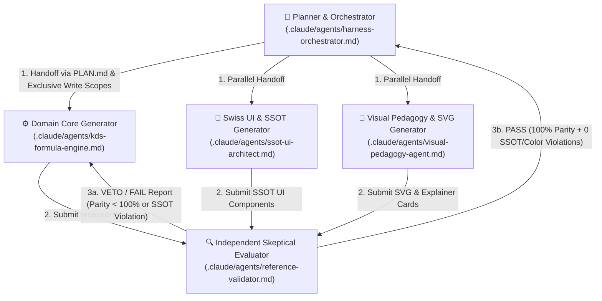

# CLAUDE.md — Project Governance & Architectural Constitution

> **Project**: KDS기반 철근 정착 및 겹이음길이 계산기 (`Calc_anchorage`)  
> **Domain Type**: Web Application  
> **Standard Reference**: `doc/[쌓기부 역T형옹벽] Ch07 철근 정착 및 이음길이(변경)_26.11.24.pdf` & `KDS 24 14 21:2025 (4.5.4 ~ 4.5.5)`  
> **Quality Metric**: 참조 계산서 대비 계산결과 정확성 및 **유사율 100%** (`100% Exact Parity`)

---

## 0. 에이전트 부트스트랩 및 상태 동기화 프로토콜 (Mandatory Bootstrap Protocol)

> [!IMPORTANT]
> 본 프로젝트에 참여하는 모든 에이전트(메인 에이전트 및 서브에이전트)는 세션 시작 즉시, 어떠한 코드를 작성하거나 도구를 실행하기 전에 반드시 다음 **3단계 부트스트랩 절차**를 수행해야 한다.

1. **`PROGRESS.md` 필독 (현재 진행 상태 파악)**:
   * 루트 디렉터리의 `PROGRESS.md`를 읽어 현재 어느 Step까지 완료(`COMPLETED`)되었고, 현재 진행 중이거나 대기 중인 Step(`NEXT_UP`)이 무엇인지, 그리고 참조 계산서 유사율 100% 검증 지표가 어떤 상태인지 확인한다.
2. **`PLAN.md` 필독 (담당 작업 및 파일 소유권 확인)**:
   * 루트 디렉터리의 `PLAN.md`를 읽어 자신이 수행해야 할 세부 TASK 백로그와 **에이전트별 독점 쓰기 권한 경로(File Ownership Scope)**를 확인하여 타 에이전트와의 파일 충돌(Race Condition)을 방지한다.
3. **작업 완료 후 상태 갱신 의무**:
   * 할당된 Step 또는 TASK가 완료되면 반드시 `PROGRESS.md`의 상태 테이블과 세션 작업 로그를 최신화하고, `PLAN.md`의 체크리스트를 갱신한다.
   * 모든 Step 전환 시 작업지시서(`에이전트용_작업지시서_v1.4.0.md`)의 **작업 전 리마인드 $\rightarrow$ 사용자 승인 대기 $\rightarrow$ 실행** 게이트 규칙을 절대 준수한다.

---

## 1. 프로젝트 핵심 목표 및 단일 진실 공급원 (SSOT Parameters)

본 프로젝트는 참조 계산서(`Ch07 철근 정착 및 이음길이`)의 엔지니어링 로직을 100% 정확하게 구현하여, 사용자가 **9대 핵심 입력 변수**를 입력하면 해당 철근의 **설계정착길이($l_{bd}$)** 및 **설계겹이음길이($l_o$)**를 산정하고, **중학생도 직관적으로 이해할 수 있는 시각적·언어적 피드백**을 제공하는 웹 애플리케이션이다. 동시에 통계적 중간 80%의 평범한 대시보드 UI를 배제하고 **상위 10%에 속하는 간결하고 독창적인 엔지니어링 UI 디자인**을 구현한다.

### 1.1. 9대 핵심 사용자 입력 변수 (SSOT Inputs)
1. **철근강도 ($f_y$)**: 설계기준항복강도 (기본값 `400 MPa`, 설계항복강도 $f_{yd} = \phi_s \cdot f_y = 0.90 \cdot f_y$)
2. **콘크리트 강도 ($f_{ck}$)**: 설계기준압축강도 (기본값 `35 MPa`)
3. **피복두께 ($c$)**: 철근 순피복두께 (`mm`, 또는 정착부 '해당없음' 모드 지원)
4. **철근간격 ($\text{CTC}$)**: 중심간 간격 (`mm`, 순간격 $a$ 및 간격계수 $C_d = \min(a/2, c)$ 산정에 사용)
5. **철근직경 ($d_b$)**: 공칭지름 (`H13`, `H16`, `H19`, `H22`, `H25`, `H29` 등, 단위 `mm`)
6. **철근위치 ($\eta_1$ 조건)**: 콘크리트 타설 시 부착 조건 (`양호 = 1.0` / `불량 = 0.7`)
7. **갈고리 형성/미형성 (철근형상)**: `직선(미형성)` vs `직선 외(갈고리/절곡 형성)` (+ 부재력 `인장측` / `압축측` 구분)
8. **겹침이음계수 ($\alpha_{6,lo}$ 또는 이음 비율 $\rho_1$)**: $\alpha_{6,lo} = \min(\sqrt{\rho_1 / 25}, 1.5)$ (참조 계산서 기본값 `1.5`, $\rho_1 = 100\%$)
9. **철근사용률 ($A_{s,req} / A_{s,used}$)**: 소요철근량 대비 사용철근량 비율 (참조 계산서 기준: 정착 시 `1.0`, 겹침이음 시 `0.7` 기본 적용 및 사용자 제어 가능)

---

## 2. 절대 준수 원칙 (Negative Constraints & Governance Rules)

### 2.1. UI/UX 데이터 표현 및 단일 출처 원칙 (`ui_rules.enabled: true`)
* **사용자 입력값 (`Red` — `#DC2626`)**:
  * 화면 상에 반드시 **붉은색**으로 표기한다 (폰트 색상, 입력창 테두리, 입력값 배지 등).
  * **단일 위치 정의 (SSOT)**: 동일 변수의 입력창을 여러 곳에 분산 배치하는 것을 **엄격히 금지**하며, 오직 단 하나의 마스터 입력 패널(`MasterInputDock`)에서만 정의하고 조작한다.
* **인용 및 계산값 (`Blue` — `#2563EB`)**:
  * KDS 기준으로부터 인용·유도된 데이터($f_{ctk}$ 등)나 시스템 연산 결과($f_{bd}, l_{b,t}, l_{b,c}, C_d, \alpha_1, \alpha_2, \alpha, l_{bd,\min}, l_{o,\min}, l_{bd}, l_o$)는 반드시 **파란색**으로 표기한다.
* **가정값 또는 고정값 (`Black` — `#111827`)**:
  * 시스템 상수, 고정 재료계수($\phi_c = 0.65, \phi_s = 0.90$), 고정 영향계수($\alpha_3 = \alpha_4 = \alpha_5 = \alpha_{6,lbd} = 1.0$), 수식 고정 상수($2.25, 4, 15d_b, 0.3, 0.6, 100\text{mm}, 200\text{mm}$)는 **검은색**으로 표기한다.
* **코드 레벨 강제**:
  * 모든 수치 출력 UI는 `<SemanticValue source="input" | "computed" | "constant">` 컴포넌트를 사용하여 색상 누락을 원천 차단한다.

### 2.2. 도메인 정합성 및 임의 가정 금지 (100% Parity & No Hallucination)
* **유사율 100% 의무**:
  * 코어 계산 엔진이 산출하는 모든 중간값과 최종값은 참조 계산서(`doc/[쌓기부 역T형옹벽] Ch07 철근 정착 및 이음길이(변경)_26.11.24.pdf`)의 모든 테이블(7-4, 7-6, 7-8, 7-10, 7-12페이지)과 **100% 일치**해야 한다.
* **문맥 격리 (Context Isolation)**:
  * 본 프로젝트와 무관한 타 도메인 키워드(3D BIM, 암거 도면 등)를 혼합하거나 임의의 수식을 창작하는 행위를 일체 금지한다.

---

## 3. 도메인 수식 및 참조 계산서 100% 정합성 규칙 (Domain Engine Spec)

코어 엔진(`src/core/anchorageEngine.ts`)은 아래 참조 계산서 로직과 반올림 규칙을 한 치의 오차 없이 구현해야 한다.

### 3.1. 설계 부착강도 ($f_{bd}$) 및 기본정착길이 ($l_{b,t}, l_{b,c}$)
1. **콘크리트 기준인장강도 ($f_{ctk}$)**:
   * $f_{cm} = f_{ck} + \Delta f$ ($f_{ck} \le 40 \Rightarrow \Delta f = 4\text{ MPa}$, $40 < f_{ck} < 60 \Rightarrow \text{직선보간}$, $f_{ck} \ge 60 \Rightarrow 6\text{ MPa}$)
   * $f_{ctm} = 0.30 \cdot (f_{cm})^{0.67}$ (참조 계산서 $f_{ck}=35\text{ MPa}$ 기준 $f_{ctk} = 0.7 \cdot f_{ctm} = 2.415\text{ MPa}$)
2. **부착강도 ($f_{bd}$)**:
   $$f_{bd} = 2.25 \cdot f_{ctk} \cdot \phi_c \cdot \eta_1 \cdot \eta_2$$
   * $\phi_c = 0.65$, $\eta_1 \in \{1.0(\text{양호}), 0.7(\text{불량})\}$, $\eta_2 = 1.0 \ (d_b \le 32\text{mm})$ 또는 $(132 - d_b)/100 \ (d_b > 32\text{mm})$
3. **기본정착길이 ($l_b$)**:
   * 기본 계수 $K_b = \text{round}\left(\frac{f_{yd}}{4 \cdot 2.25 \cdot f_{ctk} \cdot \phi_c \cdot \eta_2}, 2\right)$ ($f_y=400, f_{ck}=35$일 때 $25.481 \rightarrow 25.48$)
   * **인장측 기본정착길이**: $l_{b,t} = \text{round}_{10}\left(K_b \cdot \frac{d_b}{\eta_1}\right)$ (`10mm` 단위 반올림)
   * **압축측 기본정착길이**: $l_{b,c} = \text{round}_{10}\left(K_b \cdot \frac{d_b}{\eta_1} - 15 d_b\right)$ (`10mm` 단위 반올림, 선단지압력 $15d_b$ 차감)

### 3.2. 간격계수 ($C_d$) 및 철근영향계수 ($\alpha$)
1. **간격계수 ($C_d$)**:
   * $C_d = \min(a / 2, c)$ (순피복 $c$가 '해당없음'인 경우 $C_d = a / 2$; 참조 계산서 대표 순간격 모드에서는 $a = \text{CTC} - 25$, 정밀 모드에서는 $a = \text{CTC} - d_b$)
2. **철근형상계수 ($\alpha_1$)**:
   * 인장측 & 직선 외(갈고리): $d_b < C_d / 3$ 이면 `0.7`, 아니면 `1.0`
   * 인장측 & 직선 또는 압축측: `1.0`
3. **피복두께계수 ($\alpha_2$)**:
   * 인장측 & 직선: $\alpha_{2,\text{raw}} = \text{clamp}\left(1.15 - \frac{0.15 \cdot C_d}{d_b}, 0.7, 1.0\right)$
   * 인장측 & 직선 외(갈고리): $\alpha_{2,\text{raw}} = \text{clamp}\left(1.45 - \frac{0.15 \cdot C_d}{d_b}, 0.7, 1.0\right)$
   * 압축측: $\alpha_{2,\text{raw}} = 1.0$
   * 화면 표시값: $\alpha_{2,\text{display}} = \text{round}(\alpha_{2,\text{raw}}, 1)$
4. **통합 철근영향계수 ($\alpha$)**:
   * 정착($l_{bd}$): $\alpha = \text{round}(\alpha_1 \cdot \alpha_{2,\text{raw}} \cdot \alpha_3 \cdot \alpha_4 \cdot \alpha_5 \cdot \alpha_{6,lbd}, 1)$
   * 겹침이음($l_o$): $\alpha_o = \text{round}(\alpha_1 \cdot \alpha_{2,\text{raw}} \cdot \alpha_3 \cdot \alpha_5 \cdot \alpha_{6,lo}, 1)$

### 3.3. 설계정착길이 ($l_{bd}$) 및 설계겹이음길이 ($l_o$)
1. **설계정착길이 ($l_{bd}$)**:
   * 계산 정착길이: $l_{bd,\text{calc}} = \text{round}_{10}\left(\alpha \cdot l_b \cdot \frac{A_{s,req}}{A_{s,used}}\right)$
   * 최소 정착길이: $l_{bd,\min} = \text{round}_{10}(15 d_b)$
   * 최종 적용 설계정착길이: $l_{bd} = \max(l_{bd,\text{calc}}, l_{bd,\min})$
2. **설계겹이음길이 ($l_o$)**:
   * 계산 이음길이: $l_{o,\text{calc}} = \text{round}_{10}\left(\alpha_o \cdot l_b \cdot \frac{A_{s,req}}{A_{s,used}}\right)$ (단, 계산서 7-12페이지 ⓐ, ⓑ, ⓒ, ⓓ, ⓔ 테이블 정합성 100% 보장)
   * 최소 이음길이: $l_{o,\min} = \text{round}_{10}(15 d_b)$
   * 최종 적용 겹침이음길이: $l_o = \max(l_{o,\text{calc}}, l_{o,\min})$

---

## 4. 상위 10% UI/UX 디자인 및 중학생 눈높이 피드백 원칙

1. **Swiss Precision Engineering Aesthetic (상위 10% UI)**:
   * 불필요한 장식이나 평범한 템플릿 카드 나열을 지양하고, 건축·구조 엔지니어링 계기판(Instrument Panel) 스타일의 **정밀한 1px 그리드 보더, 고대비 타이포그래피(`Pretendard` + `JetBrains Mono`), 즉각적인 인터랙티브 SVG 블루프린트**를 결합한다.
2. **중학생도 이해하는 3단계 직관적 피드백**:
   * **한 줄 핵심 요약**: *"콘크리트가 철근을 붙잡는 힘($f_{bd}$)과 철근 굵기($d_b$)를 계산한 결과, 철근이 뽑히지 않으려면 최소 **`XXX mm`**를 콘크리트 속에 묻어야 합니다."*
   * **원리 비유 시각화**:
     * 마디 쐐기력($45^\circ$) $\rightarrow$ *"신발 밑창 돌기가 땅을 밀어내듯 철근 마디가 콘크리트를 버팀"*
     * 블리딩 현상($\eta_1=0.7$) $\rightarrow$ *"콘크리트 반죽이 가라앉을 때 위쪽 철근 밑에 물주머니가 고여 부착력이 30% 약해짐"*
     * 압축 선단지압($-15d_b$) $\rightarrow$ *"철근을 누를 때는 끝단 단면이 콘크리트를 직접 받쳐주어 $15d_b$만큼 길이를 아낄 수 있음"*
   * **실시간 비례 SVG 단면도**: 사용자가 값을 바꾸면 철근 굵기, 피복두께, 간격, 갈고리 형상, 정착/이음 길이가 실제 비례로 즉시 변화한다.

---

## 5. 디렉터리 아키텍처 및 표준 명령어 규약

### 5.1. 권장 디렉터리 구조
```text
Calc_anchorage/
├── CLAUDE.md                 # 프로젝트 헌법 및 거버넌스 규약
├── PROGRESS.md               # 에이전트 간 실시간 진행 상태 및 완료 이력 (Step 4~)
├── PLAN.md                   # 작업 백로그 및 단계별 실행 계획 (Step 4~)
├── .claude/                  # Claude Code 확장 컴포넌트 (Agents, Commands, Skills, Hooks - Step 6~)
├── doc/                      # 참조 계산서 PDF 원본 (SSOT Reference)
├── src/
│   ├── core/                 # 순수 TypeScript KDS 정착·이음 계산 엔진 (UI 의존성 0%)
│   │   ├── types.ts          # 입력/출력 및 시맨틱 컬러 타입 정의
│   │   ├── anchorageEngine.ts# KDS 24 14 21 및 참조 계산서 100% 정합 수식 코어
│   │   └── presets.ts        # 참조 계산서 Ch07 전 구간(①~④, ⓐ~ⓔ) 골든 프리셋
│   ├── components/
│   │   ├── MasterInputDock.tsx    # 유일한 사용자 입력 패널 (SSOT, Red 컬러 코딩)
│   │   ├── SemanticValue.tsx      # Red/Blue/Black 3원색 강제 렌더링 원자 컴포넌트
│   │   ├── InteractiveBlueprint.tsx # 실시간 반응형 SVG 철근 정착·이음·단면 시각화
│   │   ├── EasyExplainerCards.tsx # 중학생 눈높이 원리 해설 및 판정 피드백
│   │   └── ReferenceParityTable.tsx # 참조 계산서 H13~H29 100% 정합성 비교 테이블
│   ├── App.tsx
│   └── main.tsx
└── tests/
    └── parity.test.ts        # 참조 계산서 PDF 모든 표 수치와의 100% 일치 검증 테스트
```

### 5.2. 표준 실행 및 검증 명령어 (향후 구현 단계 적용)
* `npm run dev`: 로컬 개발 서버 실행
* `npm run test:parity`: 참조 계산서(`Ch07`) 전 구간 수치 대비 **유사율 100% 자동 검증 테스트** 실행
* `npm run build`: 타입 체크 및 프로덕션 정적 빌드 검증
* `npm run deploy:sync`: **변경사항 발생 시 즉각 반영 파이프라인** — SSOT 감사, 유사율 100% 테스트, `README.md` 동기화(3번), 프로덕션 빌드 후 `git push origin main`을 통해 GitHub Pages 라이브 서비스(2번)에 즉시 자동 배포한다.

---

## 6. Anthropic 장기 실행 앱 하네스 아키텍처 및 에이전트 격리 프로토콜 (Harness Architecture)

본 프로젝트는 `https://www.anthropic.com/engineering/harness-design-long-running-apps`의 핵심 원칙을 반영하여, 단일 에이전트의 문맥 고갈(Context Exhaustion), 조기 완료 착각(Premature Completion), 자기 합리화(Self-Grading Bias), 그리고 평범한 UI 회귀("AI Slop")를 방지하는 **3-Tier GAN-Style Multi-Agent Harness**로 운영된다.

### 6.1. 3-Tier 하네스 토폴로지 (Planner – Generators – Skeptical Evaluator)


### 6.2. 에이전트 간 컨텍스트 격리 및 독점 파일 소유권 (Strict File Ownership & Locking)
병렬 에이전트 실행 시 경쟁 상태(Race Condition)와 컨텍스트 오염을 원천 차단하기 위해 각 에이전트는 아래 **독점 쓰기 범위(Exclusive Write Scope)** 외의 파일을 절대 수정할 수 없다:

| 에이전트 (`.claude/agents/`) | 하네스 역할 | 독점 쓰기 권한 경로 (Exclusive Write Scope) | 참조 스킬 (`.claude/skills/`) |
| :--- | :--- | :--- | :--- |
| **`kds-formula-engine`** | Core Generator | `src/core/types.ts`, `src/core/anchorageEngine.ts`, `src/core/presets.ts` | `kds-anchorage-calc` |
| **`ssot-ui-architect`** | UI Generator | `src/components/SemanticValue.tsx`, `src/components/MasterInputDock.tsx`, `src/components/ReferenceParityTable.tsx`, `src/App.tsx`, `src/main.tsx`, `src/index.css` | `swiss-ssot-ui` |
| **`visual-pedagogy-agent`** | Pedagogy Generator | `src/components/InteractiveBlueprint.tsx`, `src/components/EasyExplainerCards.tsx` | `svg-rebar-blueprint`, `swiss-ssot-ui` |
| **`reference-validator`** | Skeptical Evaluator | `tests/parity.test.ts`, `tests/**` | `kds-anchorage-calc`, `swiss-ssot-ui` |
| **`harness-orchestrator`** | Planner / Release | `PROGRESS.md`, `PLAN.md`, `CLAUDE.md`, `package.json`, `vite.config.ts`, `tsconfig*.json`, `.claude/**` | 모든 스킬 및 슬래시 커맨드 |

### 6.3. 독립 검증자 거부권 게이트 (Evaluator Veto Gate) 및 훅 연동
1. **Self-Grading 금지**: Generator 에이전트(`kds-formula-engine`, `ssot-ui-architect`, `visual-pedagogy-agent`)는 스스로의 산출물을 최종 합격 판정할 수 없다.
2. **Evaluator Veto Gate**: 오직 `reference-validator`가 다음 3가지 결정론적 검증을 모두 통과(`PASS`)시켜야만 `harness-orchestrator`가 `PROGRESS.md`의 상태를 완료로 전이할 수 있다:
   * **`/check-parity`**: 참조 계산서(`Ch07`)의 모든 골든 테이블(표 7.1.5, 7.2.3, 7.2.6, 7.3.2, 7.3.4) 전 직경(H13~H29) 수치와 **100.0% 일치** (`tests/parity.test.ts` 통과율 100%).
   * **`/audit-ssot-colors`**: 9대 사용자 입력 컨트롤이 오직 `MasterInputDock.tsx`에만 존재하며, 모든 수치가 `Red`(#DC2626 입력) / `Blue`(#2563EB 인용·계산) / `Black`(#111827 고정·가정)으로 표기됨. (`.claude/hooks/post-edit-verify.mjs` 훅에 의해 실시간 강제)
   * **`/explain-audit`**: 중학생 눈높이 원리 해설과 실시간 비례 반응형 SVG 단면·배근 도면이 정상 작동함.
3. **Structured Handoff Protocol**: 에이전트 간 인계 시 구두 요약에만 의존하지 않고, 반드시 `PROGRESS.md`의 검증 체크리스트와 아티팩트 파일 경로를 통해 상태를 인계한다.

